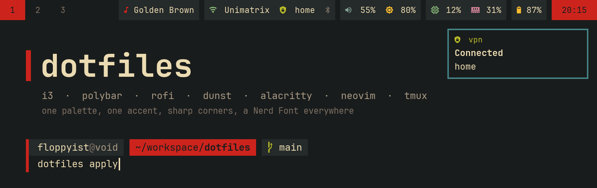
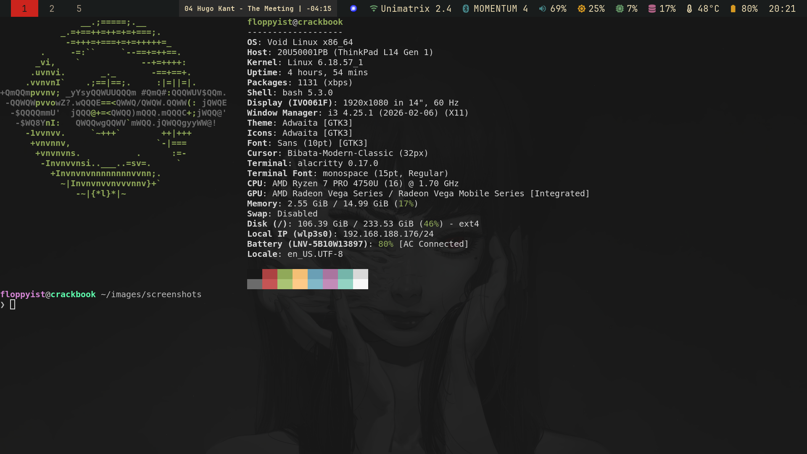
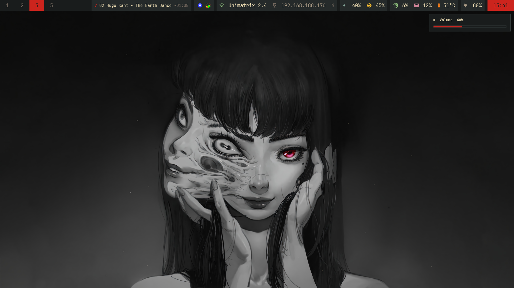
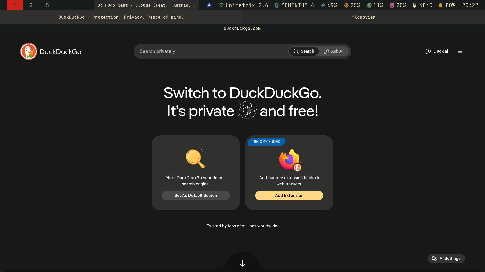
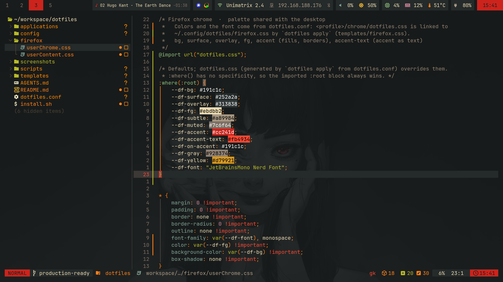
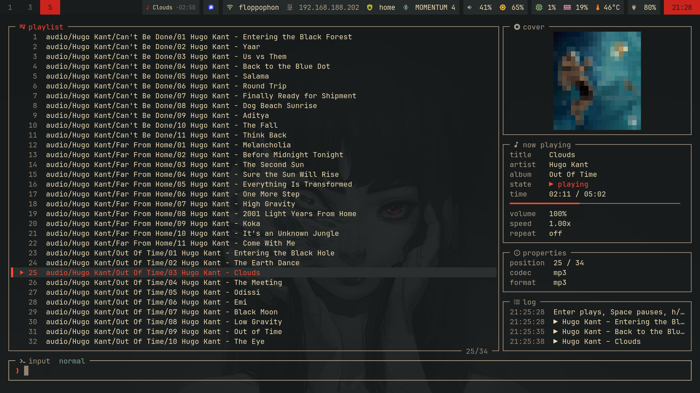
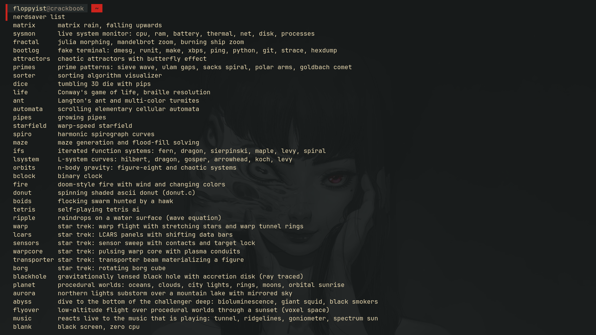
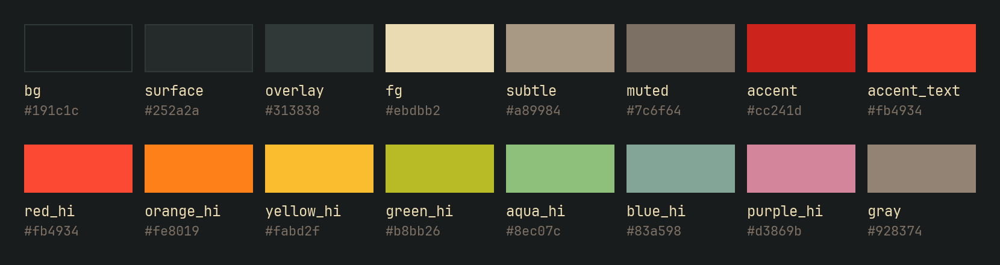

<!-- The images in assets/readme/ are drawn from dotfiles.conf: run assets/readme/render.py after changing the palette -->
<div align="center">
  
</div>

A complete i3wm desktop for **Void Linux** (X11, elogind): Polybar, Rofi, Dunst, Alacritty, tmux, Neovim and a
handful of scripts, all in one design. Gruvbox colors on a dark teal-black, one red accent, sharp corners and
JetBrainsMono Nerd Font everywhere. All of it comes from one settings file, [`dotfiles.conf`](dotfiles.conf).

<!-- Gallery: 3 x 240 px fits the README column on GitHub (830 px); click a picture for full size -->
<div align="center">
<table>
  <tr>
    <td align="center"><a href="screenshots/general.png"></a><br><sub><b>Desktop</b> · i3, Polybar, Alacritty</sub></td>
    <td align="center"><a href="screenshots/dunst.png"></a><br><sub><b>Notifications</b> · Dunst, volume OSD</sub></td>
    <td align="center"><a href="screenshots/browser.png"></a><br><sub><b>Firefox</b> · userChrome.css</sub></td>
  </tr>
  <tr>
    <td align="center"><a href="screenshots/lazyvim.png"></a><br><sub><b>Neovim</b> · LazyVim</sub></td>
    <td align="center"><a href="screenshots/mpv-wrapper.png"></a><br><sub><b>Music</b> · mpvim with album cover</sub></td>
    <td align="center"><a href="screenshots/nerdsaver-modes.png"></a><br><sub><b>Screensaver</b> · nerdsaver</sub></td>
  </tr>
</table>
</div>

## Contents

| Look | Daily use | Setup |
| --- | --- | --- |
| [Design](#design) | [Keybindings](#keybindings) | [Dependencies](#dependencies) |
| [Components](#components) | [Shell](#shell) | [Installation](#installation) |
| [Settings](#settings) | [Polybar](#polybar) | [Security notes](#security-notes) |
| [Idle and lock](#idle-and-lock) | [WiFi and VPN](#wifi-and-vpn) | [Troubleshooting](#troubleshooting) |
| | [Monitors and scale](#monitors-and-scale) | |

## Design



- **One accent** (`accent`, red by default) marks what is current or focused: the focused workspace, the clock,
  the directory in the prompt, the selected row (a `▌` bar, as in Rofi, fzf and mpvim), the cursor, progress bars.
  `accent_text` is the same color as text on dark backgrounds.
- **Grays have roles:** `surface` for capsules, input bars and selected rows, `overlay` for frames and separators,
  `subtle` for secondary text, `muted` for hints.
- **Bright gruvbox colors** identify things (the WiFi icon is aqua, volume blue, brightness yellow, a VPN tunnel
  green). Red, yellow and orange keep their meaning everywhere: error, warning, urgent.
- **Capsules:** Polybar, the prompt and the tmux status line group information in `surface` blocks with a colored
  icon, separated by a gap. Corners are sharp everywhere: windows, menus, notifications, GTK, Firefox and the
  mouse cursor.

> [!TIP]
> Change `accent = red` in `dotfiles.conf` to `blue`, `aqua` or any `#rrggbb` and run `dotfiles apply`: every
> component follows. `assets/readme/render.py` redraws the pictures of this README in the new colors.

## Components

| Part | What it is |
| --- | --- |
| **Settings** | one file, [`dotfiles.conf`](dotfiles.conf): accent, palette, scale, fonts, sizes, gaps, idle times, keyboard layout, terminal, wallpaper (see [Settings](#settings)) |
| **Monitors** | `displays`: resolution, refresh rate, scale, position, rotation, primary monitor in Rofi; a window has the same physical size on every monitor; layouts are remembered per set of monitors and come back on hotplug (see [Monitors and scale](#monitors-and-scale)) |
| **Window manager** | `i3wm` with `picom` |
| **Terminal and shell** | `Alacritty`; `bash` with a two-line prompt in the Polybar style and vi mode with vim text objects; `fzf` in the Rofi style (see [Shell](#shell)) |
| **Editor** | `Neovim` (LazyVim, gruvbox; sharp frames, Rofi-style Telescope, mode blocks in the statusline) |
| **Multiplexer** | `tmux` (prefix `Ctrl+a`; status line like Polybar) |
| **Status bar** | `Polybar`: grouped capsules, menus for WiFi, VPN and Bluetooth, event-driven updates, hides the least important capsules when it gets too full (see [Polybar](#polybar)) |
| **Notifications** | `Dunst`: a colored header per app, volume/brightness bar, new mail from `neomutt` |
| **Launcher and menus** | `Rofi`, fzf-style; one shared menu helper for all system menus |
| **Network** | WiFi menu and the `vpn` tool for NetworkManager: WireGuard, OpenVPN, Cisco, FRITZ!Box (see [WiFi and VPN](#wifi-and-vpn)) |
| **Lock and idle** | `xss-lock`, the `nerdsaver` screensaver and `i3lock-color` (clock, input line instead of a ring, status texts) |
| **Browser** | `Firefox` (`userChrome.css`/`userContent.css` in the desktop colors; no buttons, a running download is an accent line under the URL bar) |
| **GTK apps** | Adwaita dark with the palette on top (file dialogs, tray menus, polkit prompts) |
| **Mouse cursor** | its own theme, drawn in the palette by `dotfiles apply` (`scripts/dotfiles-cursors`): sharp shapes, the busy indicator in the accent; `light`, `dark` or `accent` |
| **Mail** | `neomutt` (theme in `config/mutt/theme.muttrc`; accounts stay in `~/.muttrc`) |
| **Music** | `mpvim`, a vim-style terminal UI for `mpv` with the album cover (embedded or `cover.jpg`; sharper with `chafa`, `:cover` toggles it) |
| **Scripts** | Bluetooth, WiFi, VPN, display (Windows-style and `displays`), power menu, volume/brightness OSD, screenshots (region or window on a frozen screen), screensaver, mail notifications |

## Keybindings

<kbd>Alt</kbd> is the window-manager modifier (`Mod1`), <kbd>Super</kbd> (`Mod4`) is used for system actions.

| Keys | Action |
| --- | --- |
| <kbd>Alt</kbd> <kbd>Return</kbd> | Terminal |
| <kbd>Alt</kbd> <kbd>d</kbd> | Launcher (Rofi) |
| <kbd>Alt</kbd> <kbd>h</kbd> <kbd>j</kbd> <kbd>k</kbd> <kbd>l</kbd> | Focus (with <kbd>Shift</kbd>: move the window) |
| <kbd>Alt</kbd> <kbd>1</kbd> … <kbd>5</kbd> | Workspace (with <kbd>Shift</kbd>: move the window there) |
| <kbd>Alt</kbd> <kbd>b</kbd> / <kbd>Alt</kbd> <kbd>v</kbd> | Split horizontal / vertical |
| <kbd>Alt</kbd> <kbd>f</kbd> | Fullscreen |
| <kbd>Alt</kbd> <kbd>Shift</kbd> <kbd>Space</kbd> | Toggle floating |
| <kbd>Alt</kbd> <kbd>Space</kbd> | Focus between tiled and floating windows |
| <kbd>Alt</kbd> + left drag / right drag | Move / resize a floating window (tiled: move it in the layout / resize the split) |
| <kbd>Alt</kbd> <kbd>r</kbd> | Resize mode (<kbd>h</kbd> <kbd>j</kbd> <kbd>k</kbd> <kbd>l</kbd>, leave with <kbd>Return</kbd> or <kbd>Esc</kbd>) |
| <kbd>Alt</kbd> <kbd>Shift</kbd> <kbd>q</kbd> | Close the window |
| <kbd>Alt</kbd> <kbd>Shift</kbd> <kbd>r</kbd> | Restart i3 |
| <kbd>Alt</kbd> <kbd>Shift</kbd> <kbd>e</kbd> | Power menu (lock, suspend, log out, reboot, shut down) |
| <kbd>Super</kbd> <kbd>l</kbd> | Lock the screen |
| <kbd>Super</kbd> <kbd>p</kbd> | Display menu (PC screen only, duplicate, extend, second screen only, arrange) |
| <kbd>Super</kbd> <kbd>Shift</kbd> <kbd>p</kbd> | Arrange monitors (`displays`) |
| <kbd>Super</kbd> <kbd>b</kbd> (or the display function key) | Bluetooth on/off |
| <kbd>Super</kbd> <kbd>v</kbd> | VPN menu |
| <kbd>Print</kbd> / <kbd>Shift</kbd> <kbd>Print</kbd> | Screenshot / region screenshot (also copied to the clipboard) |
| Volume and brightness keys | Change the value, shows an on-screen bar |

**Region screenshot** (<kbd>Shift</kbd> <kbd>Print</kbd>): the screen freezes and dims, a bar at the top shows the
keys. Drag to take a region (its size is shown next to it), click to take the window under the pointer, <kbd>Return</kbd>
for the whole monitor, <kbd>Esc</kbd> or a right click to cancel. Lines through the pointer show where it is. Without
input it cancels itself after 30 s.

Terminal tools started from Rofi (audio mixer, htop, neomutt) open as a centered floating window
(`terminal.sh --float`, with the terminal from `dotfiles.conf`).

## Shell

The prompt has two lines (see the picture at the top). The first one is built like Polybar: `user@host` behind
an accent bar (a red `ROOT@host` block for root), the directory in the accent block (last directory bold), then
capsules for git (branch, changes, ahead/behind; a `!` instead of the changes in a repository whose own config could run programs, see [Security notes](#security-notes)), the exit code or signal of the last command, background jobs
and the duration of commands that took 2 s or longer. The second line is the input line; its `▌` shows the vi mode.

- **Vi mode** (readline's own): <kbd>Esc</kbd> switches to normal mode (block cursor, yellow `▌`), <kbd>i</kbd>/<kbd>a</kbd>
  back to insert mode (bar cursor, accent `▌`). Motions, `c`/`d`/`y`, counts, `p`, `u`, `.` work, plus the text
  objects `iw aw iW aW i" a" i' a'` `` i` a` `` `i( a( i[ a[ i{ a{ i< a<` (also `ib`, `iB`) after `c`, `d` or `y`.
  <kbd>v</kbd> opens the line in Neovim (`$VISUAL`); it runs when you save and quit.
- **History and fzf:** <kbd>Up</kbd>/<kbd>Down</kbd> search the history for lines starting with what is typed;
  <kbd>Ctrl</kbd> <kbd>r</kbd> (history), <kbd>Ctrl</kbd> <kbd>t</kbd> (files) and <kbd>Alt</kbd> <kbd>c</kbd> (cd)
  open fzf in place of the second prompt line, styled like Rofi (input on top, accent bar on the selected row).
- **Fast:** all of it is readline itself (`~/.inputrc`, `config/bash/vim.bash`), nothing runs while you type, and the
  prompt starts no subshell (bash 5.3). A new shell starts in about 20 ms; `git` only runs inside a repository.
- **Emacs keys instead:** remove `set -o vi` from `.bashrc`; the prompt then always shows the insert-mode bar.

## Polybar

Click the WiFi, VPN or Bluetooth capsule for its menu; right-click VPN or Bluetooth to toggle it (VPN: the last
used profile). Click the IP address to copy it, the music to play/pause (right-click: next), the clock for the
full date; right-click the volume for `pulsemixer`. The mouse wheel on the volume or the brightness changes it.

**When the bar gets too full** (a long song title, many workspaces, tray icons), Polybar would cut off the
right end, the clock first. `polybar-fit` measures both halves of the bar and hides capsules until everything
fits, in this order: CPU/memory/temperature, then volume/brightness, then music. They come back as soon as
there is room again. An empty capsule (the tray without icons) takes no gap.

**Nothing polls.** Every module updates when something changes:

| Module | Updated by |
| --- | --- |
| Workspaces, volume | Polybar itself (i3 IPC, PulseAudio events) |
| Brightness | the brightness keys (IPC hook) |
| Music | `playerctl --follow`: once per second while playing, nothing while paused |
| WiFi, IP, VPN, Bluetooth, battery | `polybar-watch` with `nmcli monitor`, `ip monitor`, `gdbus monitor` (bluez), `udevadm monitor` (charger, battery); plus a slow fallback refresh |
| CPU, memory, temperature, clock | sampled inside Polybar (reads `/proc`, starts no programs) |
| Overflow (`polybar-fit`) | inotify on the module outputs, i3 IPC events, X events of the tray |

## WiFi and VPN

**WiFi:** click the WiFi capsule (or start "wifi" in Rofi) and pick a network (`●` connected, a lock icon for
secured ones). A saved profile is used as it is; for a new network, or when the saved password is rejected, Rofi
asks for the password (three attempts). WPA-Enterprise networks (eduroam) need `nm-connection-editor`.

**VPN:** <kbd>Super</kbd> <kbd>v</kbd> or a click on the shield opens the menu: every VPN profile NetworkManager knows
(`●` connected, `◐` connecting), select one to connect or disconnect. One tunnel is up at a time.

- **Add a VPN…** imports a WireGuard `.conf` (built into NetworkManager), an OpenVPN `.ovpn` or a Cisco `.pcf`
  (with the NetworkManager plugin) from Downloads, Documents, Desktop or a path; asks for the name and missing
  passwords. **FRITZ!Box (IPsec)** sets up older boxes (FRITZ!OS before 7.50) step by step; newer boxes export a
  WireGuard file. Other types (OpenConnect, L2TP, IKEv2) open `nm-connection-editor`.
- **Manage profiles…** switches autoconnect on or off and removes profiles.
- On the shell: `vpn list`, `vpn status`, `vpn up [NAME]`, `vpn down [NAME]`, `vpn toggle`,
  `vpn import [--dry-run] FILE [NAME]`, `vpn fritzbox`, `vpn autoconnect NAME on|off`, `vpn remove NAME`
  (`vpn --help`).

New VPN profiles never connect on their own. Tunnels that carry all traffic use only their own DNS servers, and a
WireGuard full tunnel also takes IPv6, so neither can leak around it. `PreUp`/`PostUp` hooks in WireGuard files
and OpenVPN scripts are never run.

> [!NOTE]
> New WiFi and VPN profiles are stored system-wide, with their keys readable by root only. Adding one, or storing a
> new password, therefore asks for your login password in a polkit dialog (once per change). Connecting and
> disconnecting need no password.

## Settings

All basic settings live in [`dotfiles.conf`](dotfiles.conf) in the repository root. After editing it, run:

```bash
dotfiles apply      # or: dotfiles edit (opens the file, applies after saving)
```

`dotfiles apply` checks every value (unknown keys and invalid values are reported, nothing is changed then),
renders `templates/*` into `~/.config/dotfiles/`, draws the cursor theme into `~/.icons/dotfiles`, and reloads i3,
Polybar, dunst and tmux. Alacritty, Rofi and fzf pick the change up by themselves, Neovim, GTK programs, Firefox and
open shells on their next start (also the new cursor). Idle times and the keyboard layout are applied immediately.

| Group | Keys |
| --- | --- |
| Colors | `accent` (gruvbox name like `red`, `blue`, `aqua` or `#rrggbb`), `accent_text`, `bg`, `surface`, `overlay`, `fg`, `subtle`, `muted` |
| Scale | `scale` (`auto` or a number like `1.25`), `auto_dpi`, `firefox_scale` (see [Monitors and scale](#monitors-and-scale)) |
| Fonts | `font` (a Nerd Font), `font_size_terminal`, `font_size_bar`, `font_size_menu`, `font_size_notify`, `font_size_window` |
| Layout | `bar_height`, `border_width`, `gaps`, `terminal_opacity`, `terminal_padding_x`, `terminal_padding_y`, `cursor_style` (`light`, `dark`, `accent`), `cursor_size` |
| Behaviour | `terminal`, `keyboard_layout`, `wallpaper`, `screensaver_after`, `lock_after`, `display_off_after` |

Other commands: `dotfiles check`, `dotfiles get accent`, `dotfiles list`.

The configs include the generated files (`include ~/.config/dotfiles/i3.conf`, `include-file` in Polybar,
`@import` in Rofi and GTK, `import` in Alacritty, `source-file` in tmux, `FZF_DEFAULT_OPTS_FILE` for fzf, a drop-in in
`~/.config/dunst/dunstrc.d/`). Shell scripts read `~/.config/dotfiles/theme.sh`.
To change the design itself, edit the configs or the templates in `templates/`.

## Monitors and scale

**Scale.** All sizes in `dotfiles.conf` are at scale 1; `scale` multiplies all of them: fonts, the bar, Rofi,
notifications, borders, gaps, the cursor, the lock screen, the screenshot overlay, Firefox, GTK and Qt programs.
Fractional values work (`1.25`, `1.5`, `1.75`).

`scale = auto` (the default) makes **a window the same physical size on every monitor**. Each monitor's scale is
its pixel density (resolution and size from the monitor itself) divided by `auto_dpi` (125):

| Monitor | dpi | scale alone |
| --- | --- | --- |
| 14" laptop, 1920×1080 | 158 | 1.25 |
| 13" laptop, 2560×1600 | 227 | 1.75 |
| 15.6" laptop, 3840×2160 | 282 | 2.25 |
| 24", 1920×1080 | 92 | 1 |
| 27", 2560×1440 | 109 | 1 |
| 27", 3840×2160 | 163 | 1.25 |

Lower `auto_dpi` makes everything larger, higher makes it smaller. A monitor's scale can also be chosen in
<kbd>Super</kbd> <kbd>Shift</kbd> <kbd>p</kbd> → the monitor → Scale.

How it works: X11 has one DPI for the whole screen. The desktop is drawn at the scale of the densest monitor
(`Xft.dpi`, in steps of 0.25, pixel-sharp there), and every other monitor shows a larger part of the screen that
the graphics card scales down by the ratio of the densities (`xrandr --scale`, the way GNOME does it on X11).
Example: a 14" laptop (163 dpi) and a 21.5" 1080p monitor (103 dpi): the desktop is drawn at 1.25, the monitor
is scaled down 1.58 times, and a window that is 10 cm wide on the laptop is 10 cm wide there too. The monitors
that are scaled down look a little softer and cost some GPU time; monitors of (almost) the same density are
never scaled. A fixed number (`scale = 1.5`) uses that on every monitor and never scales down. The graphics
card scales the picture but not its hardware mouse pointer, so the installer's Graphics module switches to a
software pointer (`/etc/X11/xorg.conf.d/20-dotfiles-swcursor.conf`): the same size on every monitor.
`firefox_scale` makes Firefox larger or smaller than the rest (`1.1` = 10 % larger).

When the scale changes (a monitor plugged in, another resolution), i3 restarts in place (the windows stay), the
bar, Rofi, dunst and open terminals follow at once; Firefox, GTK and Qt programs on their next start. GTK draws
its widgets (not the text) only at whole factors: from scale 2 on that is `GDK_SCALE`, set when you log in.

**Arrange monitors** with <kbd>Super</kbd> <kbd>Shift</kbd> <kbd>p</kbd> (or "Arrange" in <kbd>Super</kbd>
<kbd>p</kbd>): pick a monitor, then its resolution, refresh rate, scale, rotation, position (left of, right of,
above, below, mirror), make it the primary one (the bar) or turn it off/on. A change that could leave a screen dark is
reverted after 15 s unless you confirm it. The layout is remembered for this set of monitors
(`~/.local/state/dotfiles/displays.json`) and comes back when you plug them in again and when you log in. A set
of monitors without a saved layout is extended side by side, the laptop panel first. On the shell:
`displays restore`, `displays save`, `displays scale` (the desktop scale and each monitor's).

## Idle and lock

| When | What happens |
| --- | --- |
| 60 s idle | Screensaver (`nerdsaver`), any input ends it |
| 300 s idle | Screen locks, display turns off |
| (change) | `screensaver_after`, `lock_after`, `display_off_after` in `dotfiles.conf` |
| Suspend, lid close, `loginctl lock-session` | Screen locks **before** the system sleeps |

`xss-lock` owns the locking (see `config/i3/config`). While a window is fullscreen, or a program from `inhibit_procs`
in `config/nerdsaver/config` runs (opencode, pi), neither the screensaver nor the lock starts.
Notifications are paused while the screen is locked.

## Dependencies

The installer installs all of it (see [Installation](#installation)), in modules. Package names are Void Linux's.

| Module | Packages | It also |
| --- | --- | --- |
| **Desktop** (always) | `xorg-minimal xinit xauth xrdb xsetroot xset xrandr setxkbmap i3 picom polybar rofi dunst libnotify alacritty feh xclip xbanish scrot xss-lock i3lock-color libXScrnSaver dbus elogind polkit polkit-gnome python3 python3-gobject python3-cairo python3-numpy gtk+3 adwaita-icon-theme fontconfig dejavu-fonts-ttf desktop-file-utils git curl xz fzf tmux ncurses bash` | downloads JetBrainsMono Nerd Font, enables `dbus` and `elogind`, links the files, generates the theme |
| **System update** | | updates xbps and the whole system first |
| **Graphics drivers** | `mesa-dri`, plus for Intel `vulkan-loader mesa-vulkan-intel intel-video-accel`, for AMD `vulkan-loader mesa-vulkan-radeon mesa-vaapi`, for NVIDIA `mesa-vulkan-nouveau` or a proprietary driver (`nvidia`, `nvidia580`, `nvidia470`, with `void-repo-nonfree linux-headers`) | finds the GPUs itself; with `scale = auto` a software mouse pointer (`/etc/X11/xorg.conf.d/20-dotfiles-swcursor.conf`) |
| **Audio** | `pipewire wireplumber alsa-pipewire pulseaudio-utils pulsemixer` | routes ALSA programs through PipeWire |
| **Network** | `NetworkManager libnm NetworkManager-openvpn NetworkManager-vpnc network-manager-applet` | replaces dhcpcd and wpa_supplicant, takes their WiFi networks along |
| **Bluetooth** | `bluez libspa-bluetooth` | enables `bluetoothd` |
| **Laptop** | `brightnessctl` | udev rule for the backlight, your user in the group `video` |
| **Neovim** | `neovim git gcc make tree-sitter-cli ripgrep fd curl unzip nodejs openjdk21` | installs the plugins of `lazy-lock.json` |
| **Firefox** | `firefox noto-fonts-emoji` | puts the look into your profile |
| **Mail** | `neomutt` | sources the theme in your muttrc |
| **Music** | `mpv mpv-mpris playerctl ffmpeg chafa python3-Pillow` | links the MPRIS plugin into `~/.config/mpv/scripts` (Void installs it where mpv does not look; without it the music capsule does not see mpv) |
| **Tools** | `htop xdg-utils` | |
| **Start X on login** | | `startx` after logging in on tty1 |

Minimum versions: i3 4.22, polybar 3.6, picom 12 (uses the `rules` syntax), rofi 1.7, dunst 1.9, scrot 1.7,
bash 5.1 (text objects; 5.3 for the duration capsule and the prompt without subshells), tmux 3.2,
alacritty 0.14 (`[general] import`), fzf 0.66 (`--gutter`), NetworkManager 1.20.

Other distributions: install the same programs with your package manager, then run `./install.sh`; without xbps it
leaves out packages and services and only sets up your home directory. Optional: Wine for the games in
`applications/local/`.

## Installation

### 1. Get the repository

On a fresh Void Linux with i3, as your user (it has to be allowed to use sudo, the Void installer puts it in the
group `wheel`):

```bash
sudo xbps-install -S git
git clone https://github.com/floppyist/dotfiles ~/dotfiles
cd ~/dotfiles
```

Any directory works; everything is linked from where the repository is.

### 2. Run the installer

```bash
./install.sh
```

A full-screen installer in the colors of the desktop (it needs nothing but bash, also on the Linux console):

- **Complete installation** sets up everything for this machine. Modules it has no use for are left out (Bluetooth
  without an adapter, the backlight without one, starting X when a display manager is enabled).
- **Choose modules** lists the modules with what each one installs and changes; <kbd>Space</kbd> picks them.
- **Update links** only links new and moved files and generates the theme again, without packages or root: for
  after `git pull`.

Before anything changes it shows the plan: the new packages with their download size, what changes as root and
what in your home directory. sudo then asks for your password once. The steps run with a progress bar and their
live output; a step that fails can be retried or skipped, <kbd>Ctrl</kbd> <kbd>c</kbd> stops after the current step
(a running xbps is never interrupted). Every run writes a log to `~/.local/state/dotfiles/`.

The complete installation, in this order:

1. Updates the system (xbps first), then installs the packages of all modules in one transaction. The graphics
   drivers follow the GPUs it finds; with an NVIDIA card it asks which driver (nouveau or proprietary).
2. Downloads JetBrainsMono Nerd Font (7 MB from the Nerd Fonts release, checked against a fixed SHA-256) into
   `~/.local/share/fonts`, instead of all Nerd Fonts from `nerd-fonts-ttf` (1.5 GB).
3. Enables `dbus`, `elogind` and `bluetoothd`, installs the udev rule for the backlight, adds you to the group
   `video`, routes ALSA through PipeWire, makes bash your login shell if it was `sh`.
4. Links every file of `config/` into `~/.config/` (file by file, e.g. `~/.config/i3/config`, so your own files in
   those directories stay), the dotfiles into `~/`, the scripts into `~/.local/bin/` and the launchers into
   `~/.local/share/applications/` (see [Launchers](#3-launchers)). Files in the way are kept as
   `*.bak-<timestamp>`, links to files that were removed from the repository are deleted.
5. Firefox: links `userChrome.css` and `userContent.css` into your profile (Firefox creates one first if there is
   none) and switches them on in `user.js`. neomutt: adds the theme to your muttrc (or creates `~/.muttrc`).
6. Runs `dotfiles apply` (theme files, cursor theme). Without a wallpaper it puts a plain one in the background
   color at `~/images/wallpaper`.
7. Installs the Neovim plugins at the versions of `lazy-lock.json`; language servers and Treesitter parsers follow
   on the first start.
8. Makes `~/.bash_profile` start X after logging in on tty1 (`exec startx`: logging out of i3 ends the login).
9. Last, NetworkManager replaces dhcpcd and wpa_supplicant.

> [!IMPORTANT]
> The switch to NetworkManager drops the connection for a few seconds. The WiFi networks of wpa_supplicant are
> copied to NetworkManager (as root-only files, the keys never on a command line); WPA-Enterprise networks need
> `nm-connection-editor`, networks saved by iwd are picked again in the WiFi menu.

Then restart the computer (the installer offers it at the end) and log in on tty1: the desktop starts. With a
display manager, pick a session that runs `~/.xinitrc`. Every step checks first what is already done, so the
installer can run again at any time, also for a module added later.

Without the menus:

| Command | What it does |
| --- | --- |
| `./install.sh all` | the complete installation (`--skip network,neovim` leaves modules out, `--nvidia nvidia` picks the driver) |
| `./install.sh modules audio,bluetooth` | these modules (and the desktop) |
| `./install.sh plan [modules]` | shows what would happen, changes nothing |
| `./install.sh list` | the modules and their state on this machine |
| `./install.sh links` | links and theme only (also what runs without a terminal) |

`all` and `modules` ask before they start; `-y` starts right away.

> [!IMPORTANT]
> Everything is linked, not copied: editing the repository or switching git branches changes the running desktop
> (Alacritty reloads its config live, scripts and Rofi pick up changes on their next start).

`~/.local/bin` must be in your `$PATH`. `.xinitrc` and `.bashrc` both export it. The `.desktop` launchers and the
scripts rely on this, so start i3 through `.xinitrc`.

neomutt: put your account settings above the two `source` lines in your muttrc, so the theme wins, and remove your
own `color`, `index_format`, `status_format`, `status_chars` and `to_chars` lines, the theme sets them.

### 3. Launchers

The installer links a launcher only if its program is installed, so Rofi never lists one that fails: the menus of
this repository (Bluetooth, WiFi, Display, VPN) always, the others (`pulsemixer`, `htop`, `neomutt`, Firefox,
Signal and the author's own tools `calculus` and `notice`) only where their program is found (the command of
`Exec=` and `TryExec=`). Run `./install.sh links` again after installing or removing a program: it adds or removes
the launcher.

The launchers in `applications/local/` (Aseprite, Command & Conquer Generals, Factorio, World of Warcraft, Sunshine) are
machine-specific and point to install locations under `/home/floppyist/`; for them every absolute path in `Exec=` and
`Path=` must exist as well. Change `Exec=` and `Path=` to your install locations (or put your own launchers there) and
run `./install.sh links` again.

## Security notes

- The screen is locked before suspend (`xss-lock --transfer-sleep-lock`), so no content is visible on resume. If `i3lock-color` fails, plain `i3lock` is used; if that fails too, a critical notification says that the screen is **not** locked.
- Text that other people control (song titles from websites, WiFi names, Bluetooth device names, VPN profile names) is sanitized before it reaches Polybar, which would otherwise interpret `%{A:…:}` tags as clickable shell commands.
- The region screenshot overlay holds pointer and keyboard, which would keep `i3lock` from locking. It gives them up
  when logind announces suspend or a lock, and before the screensaver starts.
- System menus never act on typed text that matches no entry (`rofi -no-custom`), so a typo cannot select a random network or display mode.
- WiFi and VPN passwords and keys never appear on a command line, in the environment or in a notification: they go from Rofi's password field to NetworkManager over D-Bus (`wifi-connect` and `vpn` use libnm), and the profiles are stored root-only. Imported VPN files are parsed, never executed.
- The git prompt runs `git status` with `core.fsmonitor=false`, and not at all in a repository whose own config defines filter drivers or includes other files (the capsule then shows the branch and a `!`): both would let the repository start a program of its choice when you `cd` into it, e.g. an unpacked archive. Control characters in directory names are replaced in the prompt (no escape sequences from a crafted directory name).
- Runtime files (mpv IPC socket, screensaver log/lock, Polybar module outputs, the region screenshot) live in private directories under `$XDG_RUNTIME_DIR` (or `~/.cache`), never under predictable names in `/tmp`.
- Firefox hides the tab icons and the site identity box, which also show that a page uses the camera, microphone or screen: such a tab gets a red title instead (and a red line in the background). Pages without a secure connection show their address in red.
- The installer runs as your user and asks for sudo once; it drops the permission again when it ends (`sudo -k`). The font download is checked against a fixed SHA-256. A step that is running when you press <kbd>Ctrl</kbd> <kbd>c</kbd> or close the terminal finishes first, so an xbps transaction is never cut off halfway.
- `dotfiles.conf` values end up in configs that can run commands (i3, Polybar, tmux, shell), so `dotfiles apply` only accepts strict patterns (colors `#rrggbb`, numbers in a range, fonts and paths without quotes or shell characters).
- A command typed with a leading space is not saved in the bash history.

## Troubleshooting

- **WiFi or VPN: "not authorized":** adding a profile needs a polkit agent for the password dialog. i3 starts `polkit-gnome`; check that it is installed and running.
- **WiFi: a network keeps failing with a saved profile:** the menu asks for the password again when NetworkManager rejects the saved one. For other errors, `nmcli connection delete id "<name>"` and connect again.
- **The music capsule ignores mpv:** mpv needs the MPRIS plugin: `mkdir -p ~/.config/mpv/scripts && ln -s /usr/lib/mpv-mpris/mpris.so ~/.config/mpv/scripts/` (the installer's Music module does that), then restart mpv. `playerctl -l` lists the players it sees.
- **Everything too small or too large:** `displays scale` shows each monitor's scale; change one in <kbd>Super</kbd> <kbd>Shift</kbd> <kbd>p</kbd> → the monitor → Scale, or set a number for all (`scale = 1.5`) and run `dotfiles apply`. Firefox only: `firefox_scale`.
- **The mouse pointer is too large on one monitor:** that monitor is scaled down and the hardware pointer is not. Run the installer's Graphics module (or `sudo install -Dm644 config/xorg/20-dotfiles-swcursor.conf /etc/X11/xorg.conf.d/`) and log in again.
- **A monitor looks soft:** it is scaled down because another monitor is denser (see [Monitors and scale](#monitors-and-scale)). Give both the same scale, or set `scale` to a number.
- **Polybar hides CPU, volume or music:** the bar is full (see [Polybar](#polybar)); `polybar-fit --explain` prints the measured widths.
- **Bluetooth "Failed to power on":** the Intel AX200 (`btusb`) can get stuck after rfkill cycles. Reload the driver with `sudo modprobe -r btusb && sudo modprobe btusb`, or reboot.
- **Idle lock after updating these dotfiles:** `xss-lock` only starts with the session. Log out and back in once (an i3 restart is not enough).
- **Previous Neovim colors:** set `colorscheme = "catppuccin-frappe"` in `config/nvim/lua/plugins/colorscheme.lua`.
- **Colors look like defaults (dunst, Rofi, Alacritty):** the generated files are missing. Run `dotfiles apply`.
- **Old mouse cursor in some programs:** programs load the cursor theme when they start, i3 when it restarts. After
  the first `dotfiles apply` log out and back in once. Programs started without the session environment use
  `~/.icons/default/index.theme`; put `Inherits=dotfiles` there to get the same cursor. `dotfiles apply` leaves a
  `~/.icons/dotfiles` alone that it did not create (it says so); rename that directory.
- **GTK program still light or unchanged:** GTK reads `~/.config/gtk-3.0/` only when a program starts; restart it. Tools like `lxappearance` replace the linked `settings.ini` with their own file, run `./install.sh links` again to restore the link (your file is kept as a backup).
